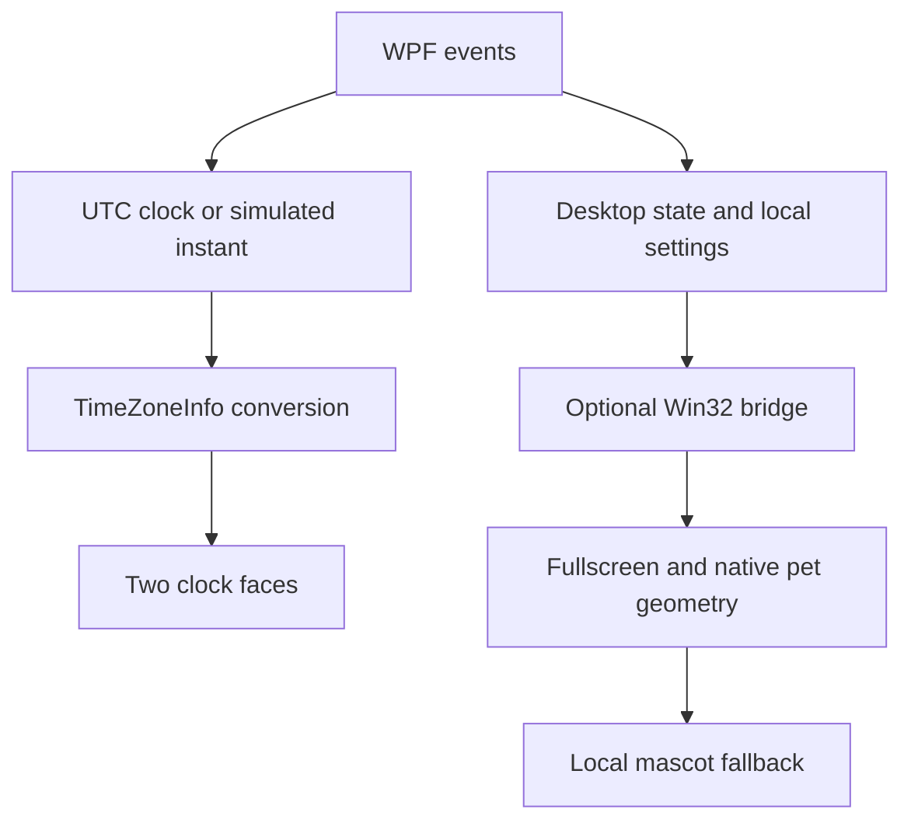

# Architecture

## Runtime and boundaries

The current baseline intentionally retains its original portable layout. `Start.cmd` invokes Windows PowerShell 5.1 in STA mode. `WorldClock.ps1` owns the WPF window, the embedded XAML, clock calculations, interaction handlers, animation and local preferences. `WindowBridge.cs` is an optional C# Win32 helper compiled with Add-Type. `Validate.ps1` checks source and WPF loading without starting the app. Assets are loaded relative to the script, not the working directory.

## Time model

`ClockModel.ps1` supplies the time-zone snapshot, preview anchor, offset and idle countdown to both the UI and validation script. A monotonic stopwatch measures inactivity independently of changes to the system clock.

Live mode samples DateTimeOffset.UtcNow once per update. Preview mode freezes an anchor rounded down to a São Paulo quarter hour, then adds the slider offset. Both faces use the same UTC instant. IDs: `E. South America Standard Time` and `GMT Standard Time`. Use current Windows time-zone rules, never assume a fixed offset. Display dates independently. Reset preview after 12 seconds of inactivity or immediately on Now. The UI timer runs every 250 ms; desktop checks every 500 ms. A 5-second blink timer switches to the alternate sprite for 170 ms.

## Desktop model

The single-instance mutex is session-local. WPF uses a transparent borderless window and a uniform Viewbox. A custom grip converts physical cursor movement into WPF device-independent coordinates. Window geometry, topmost, lock, fullscreen preference and pet signature are persisted as JSON under LocalAppData. The startup shortcut is created only upon user opt-in.

Fullscreen detection compares foreground-window geometry to the widget monitor bounds and excludes ordinary captioned maximized windows. Suppression is best-effort and must restore prior preferences after fullscreen ends. It is not a game integration. Native pet docking inspects visible, small, eligible ChatGPT/Codex overlay windows, links by cursor selection, and may reconnect only to a uniquely identified pet signature. The helper moves the selected window without resizing, reparenting, taking focus or changing its Z order. A failed association must leave local animation available. Never claim official pet support.

## Local productivity

The Today panel opens on demand from the clock menu. `TodayPanel.ps1` owns the local WPF editor and uses the system clock and local time zone. `ProductivityStore.ps1` validates notes and timed entries, stores UTC instants in a separate versioned JSON file and replaces the file atomically. A valid backup can recover data after corruption. The review instance uses its own app-data directory.

## Direction for future refactoring

Extract pure time calculations, settings validation/persistence, and the Win32 adapter into independently testable modules only as needed. Keep the presentation layer responsible for binding and events. Preserve launch compatibility and the existing settings location; document breaking changes as ADRs. Avoid adding infrastructure or AI runtime dependencies to this offline utility.
