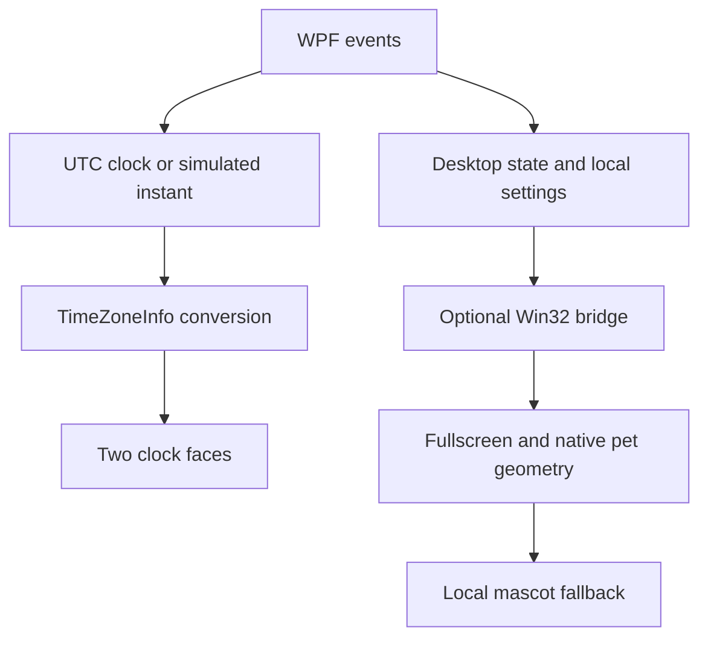

# Architecture

`Start.cmd` opens the [local desktop pet](PET-FOUNDATION.md) with an isolated profile. The following describes the preserved world clock runtime.

## Runtime and boundaries

The current baseline intentionally retains its original portable layout. `Start-Clock.cmd` invokes Windows PowerShell 5.1 in STA mode. `WorldClock.ps1` owns the WPF window, the embedded XAML, clock calculations, interaction handlers, animation and local preferences. `WindowBridge.cs` is an optional C# Win32 helper compiled with Add-Type. `Validate.ps1` checks source and WPF loading without starting the app. Assets are loaded relative to the script, not the working directory.

## Time model

`ClockModel.ps1` supplies the time-zone snapshot, preview anchor, offset and idle countdown to both the UI and validation script. A monotonic stopwatch measures inactivity independently of changes to the system clock.

Live mode samples DateTimeOffset.UtcNow once per update. Preview mode freezes an anchor rounded down to a São Paulo quarter hour, then adds the slider offset. Both faces use the same UTC instant. IDs: `E. South America Standard Time` and `GMT Standard Time`. Use current Windows time-zone rules, never assume a fixed offset. Display dates independently. Reset preview after 12 seconds of inactivity or immediately on Now. The UI timer runs every 250 ms; desktop checks every 500 ms. A 5-second blink timer switches to the alternate sprite for 170 ms.

## Desktop model

The single-instance mutex is session-local. WPF uses a transparent borderless window and a uniform Viewbox. A custom grip converts physical cursor movement into WPF device-independent coordinates. Window geometry, topmost, lock, fullscreen preference and pet signature are persisted as JSON under LocalAppData. The startup shortcut is created only upon user opt-in.

Fullscreen detection compares foreground-window geometry to the widget monitor bounds and excludes ordinary captioned maximized windows. Suppression is best-effort and must restore prior preferences after fullscreen ends. It is not a game integration. Native pet docking inspects visible, small, eligible ChatGPT/Codex overlay windows, links by cursor selection, and may reconnect only to a uniquely identified pet signature. The helper moves the selected window without resizing, reparenting, taking focus or changing its Z order. A failed association must leave local animation available. Never claim official pet support.

## Local productivity

The Today panel opens on demand from the clock menu. `TodayPanel.ps1` owns the local WPF editor and uses the system clock and local time zone. `ProductivityStore.ps1` validates notes and timed entries, stores UTC instants in a separate versioned JSON file and replaces the file atomically. A valid backup can recover data after corruption. The review instance uses its own app-data directory.

## Optional Gateway boundary

The OpenClaw integration is an offline qualification harness, not a runtime dependency or a connection from the desktop UI. It restricts a proposed meeting-brief run to explicitly selected fields, models exact run/session identity, and keeps unknown outcomes distinct from completed ones. Only an authorized, dedicated pilot can qualify a live transport. See [OpenClaw qualification](../integrations/openclaw/README.md).

## Direction for future refactoring

Extract pure time calculations, settings validation/persistence, and the Win32 adapter into independently testable modules only as needed. Keep the presentation layer responsible for binding and events. Preserve launch compatibility and the existing settings location; document breaking changes as ADRs. Avoid adding infrastructure or AI runtime dependencies to this offline utility.

## Optional Google Calendar snapshot

`Sync-Calendar.ps1` is the explicit opt-in boundary. It issues only the [events.list GET request](https://developers.google.com/workspace/calendar/api/v3/reference/events/list) for the exact supplied calendar ID. It never enumerates calendars or writes to Google. Use a short-lived OAuth token issued for `https://www.googleapis.com/auth/calendar.events.readonly` against a dedicated test account/calendar. There is no built-in sign-in, automatic refresh, or token persistence.

The import expands timed recurring instances from yesterday through the next seven days, following pages before replacing the cache atomically. It skips all-day and cancelled instances. Provider event IDs and ETags identify single events and source revisions. For recurring instances, `recurringEventId` plus the original UTC start identify the occurrence even if its scheduled time moves. Offset-free dates are not guessed. An incomplete refresh never partially replaces a snapshot; offline fallback uses only the same calendar. Cache contents are local unencrypted calendar ID, titles, timestamps, IDs and revisions; they may contain personal data. The regular and review profiles are separate. Today only reads the cache when opened and never makes a network request.

## Meeting brief contract (offline fixture)

Meeting briefs are review-only drafts tied to a single meeting revision and up to eight explicitly selected notes. New-JeremiasMeetingBriefRequest separates the pre-dispatch provider/scope/deadline/budget preview from the versioned payload. The host must not dispatch until it shows the preview and receives confirmation for that exact scope.

MeetingBrief.ps1 validates the response envelope, exact citations, zero tools, independently reported token usage and deadline. The host must also give it the current persisted meeting and allowed notes, not the original payload. The scope includes a digest of the selected source data so edits or revoked access invalidate a previous request. Only accepted drafts can be written to Activity with review-ready status and plain-text source references. This contract does not enable a live provider, guarantee semantic correctness of a model response, or grant permissions to act on its text. Integration with a live provider must enforce the same deadline and budgets at the transport boundary.

See [integration evidence and qualification gates](INTEGRATION-STATUS.md) for the status of each pilot boundary.
