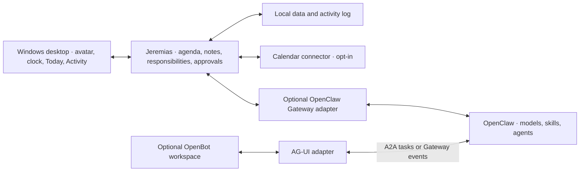

# Jeremias Companion implementation plan

**Status** · Proposed for review · 2026-11-25

Evolve Jeremias World Clock into a lightweight Windows companion with an animated three-headed dragon, a local productivity suite and optional AI that can take on recurring responsibilities. Preserve a useful offline mode. Start with one complete workflow, meeting preparation across São Paulo and Dublin, and use it to qualify the desktop, calendar and agent integration before expanding.

## Starting point

| Area | Current checkout | Work required |
| --- | --- | --- |
| Desktop | `Start.cmd` launches Windows PowerShell 5.1 in STA mode. `WorldClock.ps1` owns the WPF window, clock, Time Travel, settings, events and timers. | Extract and characterize the existing behavior before prototyping a compiled app. |
| Time | One UTC instant feeds both clocks through Windows `TimeZoneInfo`. Preview uses 15-minute steps, a ±24-hour range and a 12-second idle reset. | Preserve those rules. Give calendar and reminders their own real-time clock boundary so Time Travel only affects the preview. |
| Mascot | Bundled normal and blink sprites, plus an experimental opt-in ChatGPT pet docking flow. `WindowBridge.cs` handles native window operations and fullscreen detection. | Animate Jeremias with his own assets. Keep the native docking experiment isolated from the new mascot and agent work. |
| Settings and distribution | Per-user JSON under `%LOCALAPPDATA%\JeremiasWorldClock`. Source launcher, startup shortcut and Windows validation workflow. | Add recoverable saves, qualify migration and rollback, then package the companion. |
| Evidence | `Validate.ps1` checks script parsing, Win32 helper compilation, XAML loading and six time-zone examples. An earlier local run passed. | Rerun the baseline at implementation start. Interactive behavior, performance and the new integrations need their own evidence. |

The working desktop baseline stays PowerShell 5.1 and WPF during evaluation. Prototype C# on a supported .NET release with WPF because it can reuse the XAML, artwork and Win32 behavior while making more of the app testable. Adopt it as the primary launcher only after an architecture decision record compares measured results, runtime packaging, Windows support and settings compatibility. Keep the legacy launcher available through the transition. The current baseline is documented in the [project architecture](https://github.com/BetoBraga/jeremias-clock/blob/98675c766cb45b59db8d9c8e9d6785ee9a738d2b/docs/ARCHITECTURE.md). Package size and setup differ depending on whether the build includes the .NET runtime. [Microsoft .NET publishing guide](https://learn.microsoft.com/en-us/dotnet/core/deploying/)

## Architecture and ownership

- **Desktop and local services.** Own the avatar, calendar, focus blocks, notes, reminders, task list, notifications, settings and accessibility. The compact widget remains useful offline. A larger panel hosts the suite on demand.
- **Jeremias owns responsibilities.** Store the user's objective, selected sources, scope of allowed operations, time zone, schedule or trigger, next check, run history and pending decisions. Save the last processed source revision and reconcile it at startup. The UI shows whether work is queued, running, awaiting a decision, completed, failed or cancelled. Distinguish a requested cancellation from a confirmed stop.
- **OpenClaw executes bounded AI work.** Pair with an existing, explicitly selected Gateway first. Use a dedicated agent/profile and scoped sessions. Start with one reviewed skill and one agent. Keep custom desktop state outside OpenClaw and store only the engine's session and run references alongside local records. Connect through the documented WebSocket API using a tested Gateway/client version pair. Compare a .NET adapter with a small optional helper using the published client if the handshake and version upkeep justify it. [OpenClaw external app integration](https://docs.openclaw.ai/gateway/external-apps) · [Gateway client guide](https://docs.openclaw.ai/gateway/clients) · [Windows Hub](https://github.com/openclaw/openclaw-windows-node)
- **Separate personality, memory and knowledge.** A versioned persona defines Jeremias's tone and the three heads. Expose user preferences as editable memory. Retrieve only authorized, relevant notes or documents and show their sources. Keep transient run context scoped to the task and distinguish local data from any copy sent to a chosen engine or provider. When applicable, render persona and curated context into OpenClaw's workspace conventions. Give each skill an explicit tool list, input/output schema, version and examples. [OpenClaw agent workspace](https://docs.openclaw.ai/agent-workspace) · [OpenClaw skills](https://docs.openclaw.ai/tools/skills)
- **Permissions stay at execution boundaries.** The app authorizes its own tools. The Gateway enforces its tool policy for its agent. The pilot agent receives selected read-only inputs and returns structured drafts. It has no calendar write credentials. Evaluate the output against a fixed schema and the current source revision. Keep connector secrets in Windows credential storage. Show proposed changes and the affected account before any later external write. Record approval, refusal and outcome against the exact proposal. Treat text from notes, web pages and tools as task data.
- **OpenBot is an optional workspace.** CopilotKit folded OpenDots into OpenBot. The OpenBot application template is MIT, and its Intelligence component has separate terms. Use the documented external AG-UI agent interface for the interoperability experiment. Keep local activity events small and versioned so an adapter can translate them as needed. The Windows app can render those events directly. [OpenDots migration notice](https://github.com/CopilotKit/OpenDots) · [OpenBot licensing and architecture](https://github.com/CopilotKit/OpenBot#open-source-local-operation-and-licensing) · [AG-UI events](https://docs.ag-ui.com/concepts/events)

### Choosing the transport

| Path | Intended use | Qualify before shipping |
| --- | --- | --- |
| Jeremias to OpenClaw Gateway | Default route for optional AI in the Windows app. Use documented run, history, subscription, stop and approval operations. | Device pairing and minimum scopes, event replay or state refresh after reconnect, actual cancellation and approval recovery. Give Jeremias sessions distinct identifiers to avoid interrupting unrelated work. |
| OpenBot via AG-UI adapter to OpenClaw A2A | Optional handoff for text or structured tasks with a result that can be polled. Use a dedicated peer and agent. | Peer authentication and isolation, retry deduplication, timeout handling and verified result mapping for a pinned version pair. The documented A2A channel lacks streaming, push notifications and remote cancellation. OpenClaw approvals remain on an authorized operator surface. [OpenClaw A2A limits](https://docs.openclaw.ai/channels/a2a#a2a-10-limitations) |
| OpenBot via AG-UI adapter to OpenClaw Gateway | Evaluate if the OpenBot surface needs live progress or lifecycle controls beyond A2A. | Test the actual adapter behavior. Forward each status and decision only where its identity and authorization can be preserved. Mark unavailable controls clearly. [OpenBot external-agent support](https://www.copilotkit.ai/blog/openbot-whats-new) · [OpenClaw Gateway clients](https://docs.openclaw.ai/gateway/clients) |

One scheduler owns each responsibility. An optional workspace can display or submit scoped work. A second deployment of the same schedule requires an explicit transfer of ownership to avoid duplicate notifications and actions. The local version tracks work while its host is running and catches up after sleep or restart. Work with the PC powered off requires a separately configured host. Show which host owns each responsibility.

## First end-to-end workflow

> Keep an eye on my Dublin meetings. If a meeting moves into a focus block, tell me and prepare a short brief from the notes I selected.

1. The user selects a calendar, a meeting or series, notes and an alert preference. Show those choices before saving the responsibility. Begin development against a fixture calendar. Qualify one real calendar connector on a dedicated test account during the pilot.
2. The calendar connector delivers or discovers a revision. Use a stable source event identifier and occurrence identity for recurring meetings. Persist the provider's revision or cursor. Match repeated delivery to the existing record.
3. The local scheduler uses real time. Convert timed events to UTC for comparison and retain source zone data for display and recurrence expansion. An overlap exists when `startA < endB && startB < endA`. Keep all-day dates in their calendar zone. Flag ambiguous or invalid local times for resolution. Calculate suggested slots from the intersection of known free intervals, configured working hours and the requested duration. Represent unverified availability explicitly.
4. Jeremias records the conflict even when the AI engine is offline. If enabled, OpenClaw receives the selected meeting details and note excerpts and drafts a brief with source references. The app saves a reviewable proposal and shows it in Activity. A mascot pose and a readable status indicate that a decision is pending.
5. The pilot stops at the proposal. For later approved writes, recheck the event revision and permissions at execution time, use an idempotency key, and reconcile uncertain acknowledgements before retrying. Show the result or an actionable error.

**Pilot acceptance.** Move one event across a focus block in the live test calendar and get one alert with the correct São Paulo and Dublin times. Verify no duplicate alert when the same change arrives again or the app restarts. Confirm that local conflict detection works with the Gateway disconnected, that a model draft cites only selected sources, and that the calendar stays untouched during the read-only pilot. Capture the result of a DST case, a stale revision and a rejected decision in the validation record.

## Delivery stages

### Implementation status

The companion foundation branch adds shared clock calculations, STA regression checks, an isolated review launcher and the first local mascot response. The automated Windows checks passed locally. Interactive Windows validation, performance measurements, the compiled WPF comparison and detached flight remain open. The productivity suite, live calendar pilot and agent integrations follow the stages below.

### 0 · Baseline and stack decision

- [ ] Read the current validation workflow and record a baseline from `Validate.ps1` in Windows PowerShell STA mode and the manual matrix in `docs/TESTING.md`. Record OS build, DPI, monitor layout, startup and idle measurements.
- [x] Characterize the clock conversion and preview calculations with automated DST, midnight, step, bound and reset timing checks.
- [ ] Complete manual characterization of interactive Time Travel, settings and desktop behavior. Preserve the 440×322 logical canvas, 60–250% scale and independence of position lock and topmost. Include corrupt settings, fullscreen fallback and missing bridge cases.
- [ ] Prototype one compiled WPF vertical slice with the existing artwork and clock. Compare to the baseline under the same conditions. Record the stack, packaging and rollout decision before changing the primary launcher.
- [ ] Design a one-time settings import, validate fields and save to a separate versioned store first. Keep the legacy settings file readable by the existing launcher. Demonstrate switching back without losing the original preferences.

**Exit.** A reproducible baseline, comparable prototype measurements and an explicit migration decision. If the compiled slice misses desktop parity or the agreed idle budget, continue with the existing launcher while resolving the observed regression.

### 1 · Jeremias comes alive

- [x] Add a local greeting and respect the Windows animation preference in the greeting and blink paths. Document the interactive review steps.

- [ ] Keep the existing dragon silhouette, colors and three heads. Add an original sprite pack with idle, blink, look, sleep, takeoff, fly, land, celebrate and needs-attention poses. Define frame timing, bounds and anchors. Fall back to the bundled still sprite when a clip is missing.
- [ ] Render the flying dragon in a separate overlay owned by Jeremias so the clock keeps its position and lock. Use a bounded route within permitted monitor work areas. Respect taskbar, DPI, fullscreen, focus and reduced-motion settings. Offer flight opt-in, interval, permitted monitors, maximum time away and a recall action. Recover to the home position if a display is removed or the window becomes unavailable.
- [ ] Run updates only when a clip or movement needs them. Keep the character from stealing focus. Provide keyboard alternatives to mouse gestures and text equivalents for status changes.

**Exit.** A repeatable demo of takeoff, landing, return and manual recall. Test 100%, 150% and 200% DPI, an unplugged secondary monitor, fullscreen restoration and reduced motion. Measure idle and flight separately.

### 2 · Local productivity suite

- [ ] Add a Today panel for upcoming events, tasks, active focus blocks and reminders. Add editable notes with quick capture and search. Support local agenda entries, recurring reminders with an explicit time zone, completed tasks and reviewable reminder history. Keep the clock's existing preview action separate from date selection.
- [ ] Store agenda, notes, reminder state and activity under the user's app-data folder. Evaluate a small SQLite store once calendar and responsibility records need transactional updates. Keep existing preferences backward-compatible. Add atomic settings writes, bounded backups and a clear import/export path for personal data.
- [ ] Add the first calendar connector in read-only mode with separate opt-in. Show last successful sync, account, errors and stale data. Use local fixtures for repeatable tests and qualify live changes on the test calendar.

**Exit.** The offline suite works without a model or a Gateway. A restart retains local edits and reminder state. Sleep, missed reminders and DST changes have documented, tested behavior.

### 3 · Delegation and OpenClaw pilot

- [ ] Add the responsibilities editor and Activity view. Keep one stable responsibility ID across runs, separate run IDs and checkpoint state. Reconcile watched items after restart and suppress duplicate notifications for the same source revision.
- [ ] Pair with a test Gateway using only the required device scopes. Deliver one reviewed meeting-brief skill. Verify behavior under wrong credentials, incompatible version, offline mode, timeouts, disconnects, reconnects and restarts. Surface clear status and retry guidance.
- [ ] Bound each run using elapsed time, tool calls, token limits and provider cost limits where available. Start with one running agent per responsibility. Save concise run summaries, source references and results. Let the user pause future checks separately from stopping a running task. Simulate invalid tool arguments, expired permissions, duplicate events and unavailable providers before the live pilot.
- [ ] Complete the São Paulo–Dublin acceptance workflow. Compare the timing and resource cost of local and cloud model configurations only where real runs are available. Clearly show when context is sent to a provider.

**Exit.** The live test-calendar pilot passes, and disconnecting OpenClaw leaves the offline suite usable. State refresh and cancellation behavior match what the selected Gateway supports. A visible run log explains errors and pending decisions.

### 4 · Advanced companion and productivity

- [ ] Add optional push-to-talk and voice replies, with microphone and speaker controls, status indicators and separate local/cloud choices. Measure voice latency and resource use. Evaluate wake words, lip sync, media reactions and optional music integrations after basic voice is reliable.
- [ ] Add persona editing, a user-editable memory view and knowledge search with source links and explicit grants. Add skills for weekly review, follow-up tracking and focus planning. Version them and add an evaluation case for each. Introduce parallel specialists where independently scoped tasks show a measured benefit.
- [ ] Add bounded calendar changes through confirmed proposals first. Evaluate one connector at a time for files, mail, messaging and media. Add permissioned screen context and guarded desktop actions only after preview, cancellation and event audit are proven for the selected use case.
- [ ] Add more calendar providers, note/task export, reviewable reports and optional cross-device sync as demand warrants. Keep readable states and backups if an integration goes away.

**Exit.** Each enabled feature has a working user flow, permission and data behavior the user can inspect, and evidence for recovery from failure.

### 5 · OpenBot bridge, distribution and character growth

- [ ] Deploy a separate test instance of OpenBot when the web or team workspace has a concrete use case. Review CopilotKit Intelligence terms for the intended deployment. Verify one read-only handoff to the dedicated OpenClaw agent. Test duplicate submissions, peer isolation, restart recovery, status mapping and the operator decision path. Choose A2A for polling or qualify a Gateway adapter for live controls. Keep this deployment outside the Windows companion installer.
- [ ] Qualify a portable build and, after the stack decision, an installer and uninstall flow on clean Windows systems. Document startup opt-in, rollback and compatibility. Add CI for the compiled path when applicable, verify artifact contents and checksums, and review signing and update options before release.
- [ ] Define the character's pose and personality guide, produce a short demo of the flight and a simple web preview, and prepare original reaction assets. Evaluate shareable stickers, a streaming overlay and a separate Pet export using the supported format. Resolve code and artwork distribution terms in consultation with the maintainer before redistributing new packs. Record reach, first use and repeat use from an opt-in pilot before investing in broader distribution. [ChatGPT Pets documentation](https://learn.chatgpt.com/docs/pets)

**Exit.** A documented, reversible distribution path. The OpenBot handoff has a separate compatibility record. Only verified integrations appear as supported in release documentation.

## Capability coverage

Use this map to track the earlier parity goal. Capabilities advance by stage and can ship independently after their acceptance checks.

| Reference | Capabilities to evaluate for Jeremias | Stage |
| --- | --- | --- |
| [ChatGPT Pets](https://learn.chatgpt.com/docs/pets) | Move, resize, hide and recall from a shortcut. Reduced motion, custom looks, text and voice quick entry, statuses and a multi-task activity tray. Consider authorized window snapshots and external avatar export separately. | 1, 3–5 |
| [CapriCore](https://github.com/CapriChooms/CapriCore) | Expressive poses and roaming, styles and themes, local or cloud models, voice and speech recognition, knowledge and memory. Evaluate compatible model imports, resource controls, music reactions, scoped files/app actions, vision, repeatable workflows and diagnostics as optional extensions. | 1, 3–5 |
| [OpenAI Dots](https://learn.chatgpt.com/docs/dots/tasks-and-memory) | Delegated responsibilities, scheduled or event-triggered checks, editable preferences, follow-ups, specialist delegation and visibility into work in progress. Validate remote continuation separately. | 3–5 |
| Jeremias | Clock and Time Travel, calendar, focus, tasks and notes. A three-headed dragon with original animations reacts to actual work status. | 0–4 |

## Validation and release gates

| Gate | Evidence |
| --- | --- |
| Time and calendar | Automated fixed dates on both sides of Irish DST transitions, midnight, half-open overlaps, recurring occurrences, preview reset and a fixture-based replay of changed events. A separate live connector run confirms behavior outside fixtures. |
| Windows and animation | Manual matrix on supported Windows builds, multiple DPI settings, fullscreen, no-focus behavior, keyboard navigation, animation fallback, recall and docking opt-in. Record unverified combinations. |
| Data and recovery | Verify settings migration and rollback, atomic updates, interrupted writes, corrupt input, calendar reauthentication, offline startup, sleep and restart with no duplicate side effects. |
| Agent behavior | Verify structured output and source attribution, denied and expired grants, untrusted note content, budget exhaustion, offline fallback, duplicate retries, cancelled runs, invalid proposals and approval binding. Log observed results and identifiers with personal data redacted. |
| Performance | On the same hardware, record time to first usable window, CPU, private memory, package size and flight frame times. Measure core idle, flight, and agent-enabled running cost separately, including child processes. Start with 20 launch samples and five minutes of idle after warm-up. Initial targets for the offline mode are ≤2 s p95 to a usable window and ≤1% average total CPU in idle on the reference PC. Ratify targets with baseline evidence and report any misses. |
| Release and privacy | The base path works offline without a model, account, admin rights, mandatory download or telemetry. Document optional providers and what data they receive. Validate install/uninstall, approved asset terms, source notices and dependency versions. |

The first implementation change is a focused baseline and characterization increment starting with `Validate.ps1`, clock and Time Travel behavior, then the Windows smoke matrix. Record results before changing the primary launcher. Update the existing architecture, design, testing and changelog material alongside behavior changes, and use the project PR template for each implementation increment.
